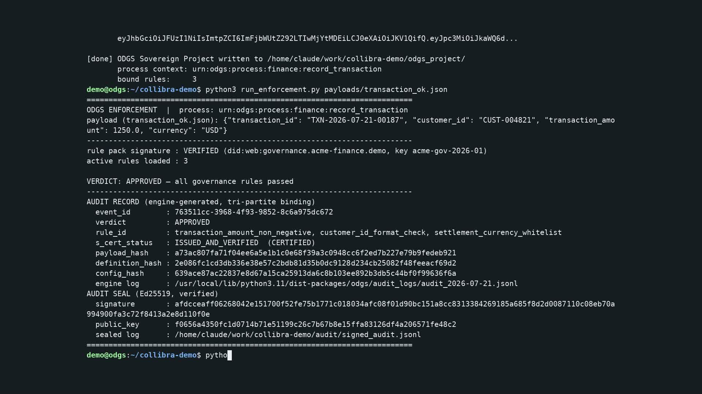
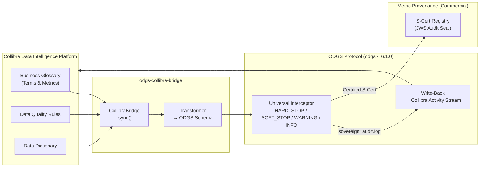

# ODGS Collibra Bridge

[](https://opensource.org/licenses/Apache-2.0)
[](https://github.com/MetricProvenance/odgs-protocol)
[](https://pypi.org/project/odgs-collibra-bridge/)
[](https://pypi.org/project/odgs-collibra-bridge/)

**Transform your Collibra Business Glossary into active ODGS runtime enforcement schemas.**

> Collibra documents your data. ODGS enforces it.

The ODGS Collibra Bridge is an **institutional connector** that translates Collibra Business Glossary assets — terms, metrics, and data quality rules — into cryptographically addressable ODGS enforcement schemas. It bridges the gap between passive data cataloguing and active regulatory enforcement, making Collibra governance decisions mechanically executable at pipeline runtime.

Architecturally aligned with federated data sovereignty principles, and on a path toward standardization.

### See it in action

[](examples/marketplace-demo/clip_collibra.mp4)

Real bridge, real engine, real ES256-signed rule pack, real Ed25519 audit seal — click to watch on GitHub. Only the Collibra API is mocked; see [examples/marketplace-demo/](examples/marketplace-demo/) for the full honest-accounting demo rig.

---

## Architecture



---

## Install

```bash
pip install odgs-collibra-bridge
```

---

## Quick Start

### Python API

```python
from odgs_collibra import CollibraBridge

bridge = CollibraBridge(
    base_url="https://your-org.collibra.com",
    api_token="your-api-token",
    organization="acme_corp",
)

# Sync Finance community → ODGS metric schemas
bridge.sync(
    community="Finance",
    output_dir="./schemas/custom/",
    output_type="metrics",
)

# Sync DQ rules → ODGS enforcement rules (HARD_STOP on violation)
bridge.sync(
    community="Data Quality",
    output_dir="./schemas/custom/",
    output_type="rules",
    severity="HARD_STOP",
)
```

### CLI

```bash
# Sync using API token
odgs-collibra sync \
    --url https://your-org.collibra.com \
    --token YOUR_API_TOKEN \
    --org acme_corp \
    --community "Finance" \
    --output ./schemas/custom/ \
    --type metrics

# Push compliance results back to Collibra activity stream
odgs-collibra write-back \
    --log-path ./sovereign_audit.log \
    --url https://your-org.collibra.com \
    --token YOUR_API_TOKEN
```

### Output Schema

A real `asset_to_rule()` output (`--type rules`):

```json
{
  "$schema": "https://metricprovenance.com/schemas/odgs/v5",
  "metadata": {
    "source": "collibra",
    "organization": "acme_corp",
    "bridge": "odgs-collibra-bridge",
    "bridge_version": "0.4.4",
    "generated_at": "2026-07-23T10:00:00+00:00",
    "asset_count": 42
  },
  "items": [
    {
      "rule_id": "net_revenue",
      "rule_urn": "urn:odgs:custom:acme_corp:rule:net_revenue",
      "name": "Net Revenue",
      "description": "Net revenue must equal gross revenue minus returns",
      "domain": "Finance",
      "severity": "HARD_STOP",
      "logic_expression": "gross_revenue - returns",
      "source_authority": "collibra:Finance Community",
      "legislative_source": "BRIDGE_GENERATED_UNATTESTED",
      "verbatim_source_text": "",
      "semantic_hash": "UNATTESTED",
      "verdict_on_pass": "PASS",
      "content_hash": "a1b2c3...",
      "provenance": {
        "bridge": "odgs-collibra-bridge",
        "bridge_version": "0.4.4",
        "synced_at": "2026-07-23T10:00:00+00:00",
        "source_url": "collibra://<asset-id>"
      }
    }
  ]
}
```

---

## Bi-Directional Write-Backs

The bridge supports **Bi-Directional Sync**: it parses your `sovereign_audit.log` offline and pushes compliance results back into the corresponding Collibra Asset's activity stream — creating a deterministic feedback loop for Governance Officers without compromising the air-gapped nature of the core ODGS protocol.

```bash
odgs-collibra write-back \
    --log-path ./sovereign_audit.log \
    --url https://your-org.collibra.com \
    --token YOUR_API_TOKEN
```

---

## Authentication

| Method | Flag | Environment Variable |
|---|---|---|
| API Token (recommended) | `--token` | `COLLIBRA_API_TOKEN` |
| Basic Auth | `--username` + `--password` | — |

---

## Regulatory Alignment

This bridge is designed for organisations governed by:

| Regulation | Relevance |
|---|---|
| **EU AI Act (2024/1689) Articles 10 & 12** | Data governance & audit trail requirements for High-Risk AI Systems |
| **DORA (Regulation EU 2022/2554)** | ICT operational resilience — data lineage and incident traceability |
| **GDPR Article 5(2)** | Accountability principle — demonstrable data governance |

> For cryptographic attestation (Ed25519 JWS audit seals and signed `.odgs-bundle` Regulation Packs for EU AI Act, DORA, and CSRD), see the **[Metric Provenance Enterprise Platform](https://www.metricprovenance.com/#suite)**.

> **Get started:** [metricprovenance.com/executive-brief](https://www.metricprovenance.com/executive-brief) (Executive Brief) · **Certified packs:** [metricprovenance.com/#suite](https://www.metricprovenance.com/#suite)

---

## Requirements

- Python ≥ 3.9
- `odgs` ≥ 6.1.0 (core protocol)
- Collibra Data Intelligence Platform (any version with REST API v2)

---

## Related

- [ODGS Protocol](https://github.com/MetricProvenance/odgs-protocol) — The core enforcement engine
- [ODGS FLINT Bridge](https://github.com/MetricProvenance/odgs-flint-bridge) — TNO FLINT legal ontology connector
- [ODGS Databricks Bridge](https://github.com/MetricProvenance/odgs-databricks-bridge) — Unity Catalog integration
- [ODGS Snowflake Bridge](https://github.com/MetricProvenance/odgs-snowflake-bridge) — Snowflake integration

---

## License

Apache 2.0 — [Metric Provenance](https://metricprovenance.com) | The Hague, NL 🇳🇱
